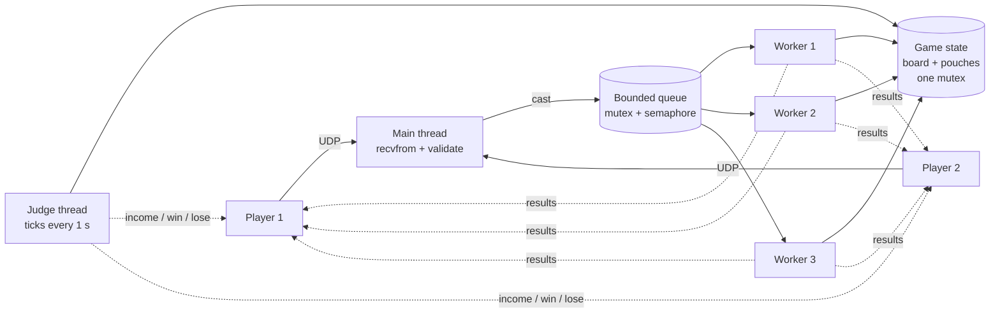

# POSIX Concurrency & Networking in C

A set of small, self-contained Linux servers in C that show how to build
**multithreaded UDP services** with nothing but POSIX: `pthread`s,
semaphores, mutexes, signals, shared memory and BSD sockets.
No frameworks and no dependencies beyond libc.

The centrepiece is **[Spell Duel](#spell-duel-server)**: a real-time
two-player game server with a thread pool, a timer-driven referee thread,
and a binary wire protocol.

## Highlights

- **Producer/consumer pipelines**: bounded queues guarded by a mutex plus
  counting semaphores, feeding fixed-size worker pools.
- **Fine-grained locking**: per-row mutexes on a shared 100×100 map so
  updates to different rows don't contend.
- **Binary protocols done carefully**: packed structs, network byte order
  (`htons`/`ntohs`), and length checks on every message type before any
  field is read.
- **Graceful shutdown**: SIGINT handled with `sigwait` in a dedicated
  thread of control, blocked threads woken by semaphore posts and a
  loopback packet, and every thread joined before resources are freed.
- **Cross-process synchronisation**: a robust, process-shared mutex in
  `mmap`'d memory that recovers (`EOWNERDEAD`) if a child dies holding it.

## Projects

| Directory | What it is | Key techniques |
|---|---|---|
| [`spell-duel/`](spell-duel/server.c) | Two-player real-time UDP game server | worker pool, referee thread, binary protocol, game state under one mutex |
| [`hq-tracker/`](hq-tracker/hq_tracker.c) | Unit-tracking "headquarters" that ingests position reports and sends orders back | listener → bounded buffer → 4 workers, per-row locks, `sigwait` shutdown |
| [`udp-thread-pool/`](udp-thread-pool/server.c) | Generic UDP request/response server | ring buffer, 4-worker pool, SIGINT-driven shutdown |
| [`process-pool/`](process-pool/main.c) | Multi-process skeleton: 10 forked workers sharing state with the parent | `fork`, `mmap(MAP_SHARED)`, robust process-shared mutex |
| [`packet-decoder/`](packet-decoder/main.c) | Minimal decoder for a packed binary datagram | packed structs, byte-order conversion, length validation |
| [`common/`](common/common.h) | Shared helpers: socket setup, EINTR-safe I/O, error handling | |
| [`snippets/`](snippets/) | Reference code: thread-safe ring buffer, queue, stack, min-heap, BST; `strtok_r` tokenisers | |

## Spell Duel server

Two players log in over UDP and fight for an 8×8 board by casting spells.
Spells cost *pebbles*. Every second the referee pays each player based on
how much of the board they hold, and a player whose pouch runs dry while
losing ground is out.

### Architecture



- **Main thread** receives datagrams, validates length, type, sender and
  argument ranges, and only then enqueues casts. Logins and quits are
  handled inline.
- **3 worker threads** pop casts, apply them to the board, and reply to
  the caster. Each worker then waits 100 ms, which limits how fast spells
  resolve.
- **Judge thread** wakes every second: prints the board, pays each player
  `floor(cells_owned / 2) - 1` pebbles (negative if they hold fewer than
  2 cells), and ends the game when someone is broke and still losing.
- A receive timeout on the socket lets the main loop notice the game
  ending without waiting for another packet. Workers are woken with
  semaphore posts so every thread can be joined cleanly.

### Wire protocol

All multi-byte integers are big-endian (network byte order).

| Message | Layout | Size |
|---|---|---|
| Login | `'l'` · pad · name (up to 14 bytes) | 3–17 B |
| Cast | `'c'` · pad · `u16 spell` · `u16 x` · `u16 y` | 8 B |
| Quit | `'q'` | 1 B |

| Spell | Id | Cost | Effect | Reply |
|---|---|---|---|---|
| Divination | 0 | 1 | Look at the 5×5 area around (x, y) | 25 × `u16`: 0 empty, 1 yours, 2 opponent's, 3 off-board |
| Summon Elemental | 1 | 3 | Claim (x, y) if it's empty | — |
| Fireball | 2 | 4 | Clear the 3×3 area around (x, y) | — |

After every cast and every referee tick the server sends the player's
pouch as a `u16`. The game ends with a single byte, `'w'` or `'l'`, to each
player. Sending quit forfeits the game.

## Building

Requires Linux, GCC or Clang, and pthreads. Each program is a single
translation unit:

```sh
gcc -std=gnu11 -Wall -Wextra -O2 -pthread -o spell-duel-server spell-duel/server.c
gcc -std=gnu11 -Wall -Wextra -O2 -pthread -o hq-tracker      hq-tracker/hq_tracker.c
gcc -std=gnu11 -Wall -Wextra -O2 -pthread -o udp-thread-pool udp-thread-pool/server.c
gcc -std=gnu11 -Wall -Wextra -O2 -pthread -o process-pool    process-pool/main.c
gcc -std=gnu11 -Wall -Wextra -O2 -pthread -o packet-decoder  packet-decoder/main.c
```

All of them compile with no warnings under `-Wall -Wextra`.

## Try it

Start the game server:

```sh
./spell-duel-server 9000
```

Then play a few moves from Python in another terminal:

```python
import socket, struct, time

SERVER = ("127.0.0.1", 9000)
alice = socket.socket(socket.AF_INET, socket.SOCK_DGRAM)
bob = socket.socket(socket.AF_INET, socket.SOCK_DGRAM)

alice.sendto(b"l\0Alice", SERVER)
bob.sendto(b"l\0Bob", SERVER)
time.sleep(0.2)

# Alice summons an elemental on (3, 3)
alice.sendto(struct.pack("!ccHHH", b"c", b"\0", 1, 3, 3), SERVER)
print("Alice's pouch:", struct.unpack("!H", alice.recv(2))[0])

# Alice forfeits. Skip Bob's pouch updates until the 1-byte result arrives
alice.sendto(b"q", SERVER)
while len(msg := bob.recv(64)) != 1:
    pass
print("Bob gets:", msg)  # b'w'
```

The other servers are just as easy to try:

```sh
./hq-tracker 9001                                  # then:
echo -n "12 34 1 Old Guard" | nc -u -w1 localhost 9001

./udp-thread-pool 9002                             # then:
echo "count these four tokens" | nc -u -w1 localhost 9002
```

## Background

This started as coursework for a university operating systems course.
Since then I've fixed the bugs I found (buffer overflows in message
parsing, servers that couldn't shut down, data races, byte-order
mistakes), restructured it into standalone programs with a shared header,
and documented the designs.
